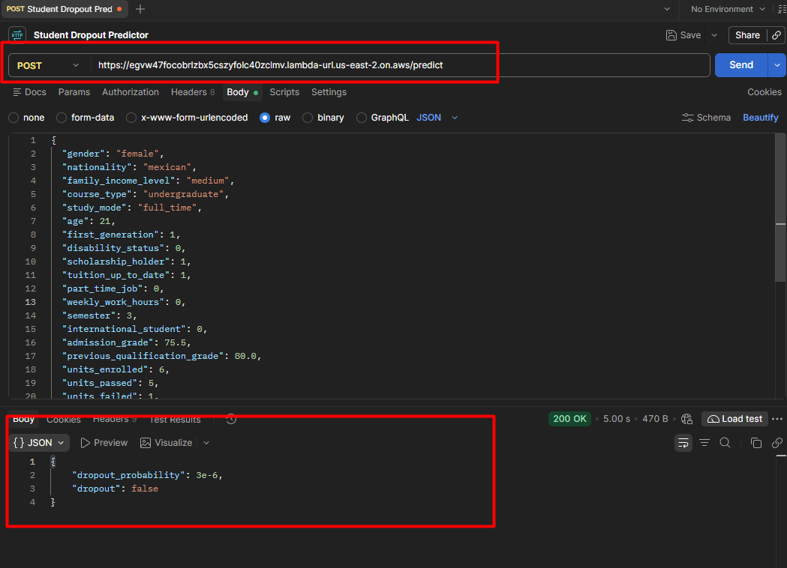

# Student Dropout Risk Prediction

A machine learning project to estimate the probability of student dropout from academic performance, attendance, study behavior, and other student characteristics. It was developed as a mid-course machine learning project and exposes its predictions through a FastAPI web service.

## 1. Problem description

Student dropout can be difficult to anticipate. Identifying students who may be at risk could help educational teams prioritize supportive interventions. The task is **binary classification**, similar to customer churn prediction:

- `dropout = 0`: the student did not drop out.
- `dropout = 1`: the student dropped out.

The service returns a dropout probability and a Boolean classification. These predictions are intended for educational demonstration, not as the sole basis for decisions affecting students.

## 2. Dataset

The project uses `student_dropout_risk_2026.csv`, containing **100,000 records and 34 original columns**. Its target is `dropout`.

The model uses **32 features** (5 categorical and 27 numerical, including binary 0/1 indicators). The `person_id` identifier and the `dropout` target are excluded from the input features.

Expected location:

```text
data/student_dropout_risk_2026.csv
```

**Data availability:** Include this CSV in the repository under `data/`, or add a working download link and instructions here before submission. No public download URL has been verified.

## Dataset Source and Acknowledgments

The dataset used in this project is **Student Academic Performance & Dropout Risk**, published on Kaggle by **mohankrishnathalla**.

**Source:** [Student Academic Performance & Dropout Risk – Kaggle](https://www.kaggle.com/datasets/mohankrishnathalla/student-academic-performance-and-dropout-risk)

All credits for the original dataset belong to its respective creator. This dataset is used for educational purposes as part of a Machine Learning course project.

The data was analyzed and used to develop a Logistic Regression model for predicting student dropout risk.

## 3. Approach and model selection

The exploration and experiments are documented in `notebook.ipynb`:

1. Data inspection, cleaning, and text normalization.
2. Exploratory data analysis (EDA), including distributions and associations with dropout.
3. Feature importance exploration using risk analysis, mutual information, correlation, and feature elimination experiments.
4. Training/validation/test split and ROC-AUC evaluation.
5. Logistic Regression regularization tuning using 5-fold cross-validation.
6. Final model evaluation on the held-out test subset.

The selected estimator is **Logistic Regression** with:

| Parameter | Value |
| --- | --- |
| `solver` | `liblinear` |
| `C` | `1.0` |
| `max_iter` | `1000` |
| Prediction threshold | `0.41` |

The 5-fold cross-validation ROC-AUC stabilized at approximately **0.903 ± 0.003** for several regularization values, so `C=1.0` was selected. The classification threshold was selected during validation based on F1-score.

### Notebook test-set results

The previously evaluated notebook model (trained using the 80% development portion) achieved approximately:

| Metric | Score |
| --- | ---: |
| ROC-AUC | 0.9056 |
| Accuracy | 0.8344 |
| Precision | 0.7299 |
| Recall | 0.7704 |
| F1-score | 0.7496 |

**Important:** `train.py` currently trains the deployable pipeline on the **full CSV** after model selection. Therefore these held-out metrics describe the notebook experiment, **not** an independent test of the subsequently refitted deployment artifact.

## 4. Project structure

```text
.
├── data/
│   └── student_dropout_risk_2026.csv
├── notebook.ipynb
├── model.py               # Feature lists and record normalization
├── train.py               # Train and serialize the pipeline
├── predict.py             # FastAPI prediction endpoint
├── val_true_test.py       # API true case test
├── val_false_test.py      # API false case test
├── pipeline.bin           # Generated trained pipeline and numeric defaults
├── pyproject.toml         # uv project dependencies
├── uv.lock                # Locked dependencies
├── .python-version        # Local Python version
├── Dockerfile
└── README.md
```

The names `val_test.py` and `pipeline.bin` refer to the scripts and artifact used in this project; generate `pipeline.bin` by running the training step if it is not committed.

## 5. Requirements and local setup

- Python **3.11** (developed using Python **3.11.17**)
- [`uv`](https://docs.astral.sh/uv/)
- Dependencies defined in `pyproject.toml` and `uv.lock` (including scikit-learn, FastAPI, and Uvicorn)
- Docker (optional, for the containerized service)

From the repository root:

```powershell
uv sync
```

To inspect and reproduce the notebook:

```powershell
uv run jupyter notebook
```

Open `notebook.ipynb` and run its cells in order. Ensure Jupyter Notebook is installed as a project dependency for this command.

## 6. Train the deployment model

Make sure the CSV is in the expected `data/` directory, then run:

```powershell
uv run python train.py
```

This script reads and normalizes the input records, calculates medians for missing numeric values, fits a `DictVectorizer` + `LogisticRegression` pipeline, and writes `pipeline.bin`. The saved pickle contains **both the fitted pipeline and numeric defaults**.

A custom dataset or artifact path can be supplied:

```powershell
uv run python train.py --data data/student_dropout_risk_2026.csv --model pipeline.bin
```

Only load pickle files produced by a trusted source and a compatible Python/scikit-learn environment.

## 7. Run the prediction API

Train the model first, then start the FastAPI service:

```powershell
uv run uvicorn predict:app --host 0.0.0.0 --port 9696
```

Interactive API documentation: **http://localhost:9696/docs**

Endpoint: **`POST /predict`**. Send a JSON object containing the student's feature values (see the `StudentData` schema exposed in `/docs`). Do **not** include `person_id` or `dropout` in the request. The API normalizes the request using the same rules and numeric defaults saved during training.

Expected response format (illustrative values):

```json
{
  "dropout probability": 0.069008,
  "dropout": false
}
```

The Boolean prediction is `true` when the estimated probability is at least **0.41**. The exact response-key spelling above matches the tested API output; update this example if the API is later changed to `dropout_probability`.

Body load example:

```json
{
  "gender": "female",
  "nationality": "domestic",
  "family_income_level": "medium",
  "course_type": "undergraduate",
  "study_mode": "full_time",
  "age": 21,
  "first_generation": 1,
  "disability_status": 0,
  "scholarship_holder": 1,
  "tuition_up_to_date": 1,
  "part_time_job": 0,
  "weekly_work_hours": 0,
  "semester": 3,
  "international_student": 0,
  "admission_grade": 75.5,
  "previous_qualification_grade": 80.0,
  "units_enrolled": 6,
  "units_passed": 5,
  "units_failed": 1,
  "gpa_semester_1": 7.8,
  "gpa_semester_2": 7.5,
  "attendance_rate": 0.85,
  "assignments_submitted_rate": 0.90,
  "library_visits_per_month": 4,
  "lms_logins_per_week": 6,
  "extracurricular_activities": 1,
  "missed_deadlines": 2,
  "stress_level": 3,
  "mental_health_support": 0,
  "satisfaction_score": 4,
  "commute_time_mins": 35,
  "sleep_hours": 7
}
```
### API False test

With the API running in one terminal, open another terminal and execute:

```powershell
uv run python val_false_test.py
```

A previously observed local response was:

```text
Prediction API test passed.
{
  "dropout probability": 0.069008,
  "dropout": false
}
```

This smoke test checks that the endpoint is reachable and returns the expected types and range; it **does not** establish out-of-sample predictive performance.

## 8. Run with Docker

After generating `pipeline.bin`, build the image from the project root:

```powershell
docker build -t dropout-risk .
```

Run the container:

```powershell
docker run --rm -p 9696:9696 dropout-risk
```

Open **http://localhost:9696/docs** and send a `POST /predict` request, or run `uv run python val_test.py` in another terminal against the containerized API.

**Before submission:** verify that your Dockerfile copies only files that exist (at minimum `model.py`, `predict.py`, and `pipeline.bin`), installs production dependencies with `uv`, and starts Uvicorn on `0.0.0.0:9696`. Stop any locally running server on port 9696 before starting the container.

## Deployment — AWS Lambda

The Student Dropout Prediction API was deployed to AWS Lambda using a Docker container, Amazon Elastic Container Registry (ECR), and AWS Lambda Web Adapter.

The Lambda Web Adapter allows the existing FastAPI application to run in AWS Lambda without modifying its prediction endpoints.

### 1. Prerequisites

Before deployment, ensure the following requirements are met:

- Docker Desktop installed and running.
- AWS CLI installed with an existing, configured AWS profile.
- An AWS account with permissions to manage Amazon ECR and AWS Lambda.
- The trained model (`pipeline.bin`) generated by `train.py`.
- The project dependencies defined in `pyproject.toml` and `uv.lock`.

Verify the AWS credentials:

```powershell
aws sts get-caller-identity --profile default
```

Replace `default` with the appropriate AWS profile if necessary.

### 2. Build the Docker Image

The Dockerfile includes Python 3.11, the `uv` package manager, FastAPI, Uvicorn, the trained model, and AWS Lambda Web Adapter.

Build the image using the Linux AMD64 architecture and disable provenance and SBOM attestations:

```powershell
docker buildx build `
    --platform linux/amd64 `
    --provenance=false `
    --sbom=false `
    --output "type=docker" `
    -t dropout-risk:lambda .
```

The container can also be executed locally:

```powershell
docker run --rm -p 9696:9696 dropout-risk:lambda
```

### 3. Create an Amazon ECR Repository

Configure the deployment variables:

```powershell
$REGION = "us-east-2"
$PROFILE = "default"
$REPOSITORY = "dropout-risk"

$ACCOUNT_ID = aws sts get-caller-identity `
    --profile $PROFILE `
    --query Account `
    --output text

$ECR_URI = "$ACCOUNT_ID.dkr.ecr.$REGION.amazonaws.com/$REPOSITORY"
```

Create the repository, if it does not already exist:

```powershell
aws ecr create-repository `
    --repository-name $REPOSITORY `
    --region $REGION `
    --profile $PROFILE
```

### 4. Authenticate Docker with Amazon ECR

```powershell
aws ecr get-login-password `
    --region $REGION `
    --profile $PROFILE |
docker login `
    --username AWS `
    --password-stdin "$ACCOUNT_ID.dkr.ecr.$REGION.amazonaws.com"
```

A successful authentication returns `Login Succeeded`.

### 5. Build and Push the Lambda-Compatible Image

To ensure compatibility with AWS Lambda, the final image was exported using the Docker V2 manifest format instead of an OCI Image Index.

```powershell
docker buildx build `
    --platform linux/amd64 `
    --provenance=false `
    --sbom=false `
    --output "type=image,name=${ECR_URI}:lambda-v2,push=true,oci-mediatypes=false" `
    .
```

Verify the manifest:

```powershell
aws ecr describe-images `
    --repository-name $REPOSITORY `
    --image-ids imageTag=lambda-v2 `
    --region $REGION `
    --profile $PROFILE `
    --query "imageDetails[0].imageManifestMediaType" `
    --output text
```

Expected result:

```text
application/vnd.docker.distribution.manifest.v2+json
```

### 6. Create the AWS Lambda Function

From the [AWS Lambda Console](https://console.aws.amazon.com/lambda/home), create a function using **Container image** as the deployment package.

Configure the following settings:

| Setting | Value |
|---|---|
| Function name | `dropout-risk-api` |
| Container image | ECR image tagged `lambda-v2` |
| Region | `us-east-2` |
| Architecture | `x86_64` |
| Memory | `1024 MB` |
| Timeout | `30 seconds` |

The memory and timeout settings were increased from the defaults after the initial execution encountered resource limits.

### 7. Configure the HTTP Endpoint

Enable a **Lambda Function URL** with the following configuration:

| Setting | Value |
|---|---|
| Auth type | `NONE` |
| Invoke mode | `BUFFERED` |
| HTTP method | `POST` |
| API path | `/predict` |

The `POST /predict` route is handled by FastAPI through AWS Lambda Web Adapter.

Public access is intended for educational testing only. No real student personal data should be submitted.

### 8. Validate the Deployment

After the function becomes active, obtain its Function URL from the AWS Console.

Run the validation script using the deployed endpoint:

```powershell
uv run python val_test.py "https://YOUR-LAMBDA-URL/predict"
```

Expected output:

```text
Prediction API test passed.
```

The response includes:

- `dropout_probability`: Estimated probability of student dropout.
- `dropout`: Boolean prediction based on the selected threshold of `0.41`.

### 9. Deployment Evidence

The deployment was verified by sending an HTTP POST request to the AWS Lambda Function URL and receiving a valid prediction response.



### 10. Resource Management

AWS Lambda uses an on-demand execution model, so the function does not require a continuously running server.

To prevent unintended access after the project evaluation, the public Function URL can be disabled or deleted. The ECR image can also be removed when no longer needed.

## 10. Limitations

- Predictions are statistical estimates, not guarantees of student outcomes.
- The model can make false-negative and false-positive predictions.
- Input fields and category labels should follow the training dataset's schema.
- Sensitive attributes such as gender, nationality, and disability status are present among the current features. Before real-world use, remove or justify these attributes, evaluate fairness, and ensure predictions are used only for supportive, non-punitive purposes.
- Academic performance data must be available at the intended prediction time to avoid temporal leakage in a real deployment.
